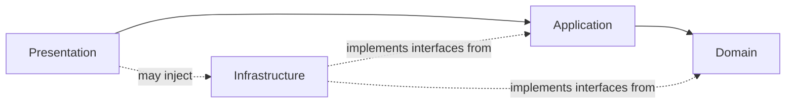

# Architecture Specification — Eight Months of Silence

**Status:** Living document. Any change to layer boundaries or dependency direction requires an ADR in `docs/DECISIONS.md`, not a silent edit here.

## 1. Layers and Dependency Direction



- **Domain** — pure C#, zero `UnityEngine` references, zero third-party engine dependencies. Contains entities, value objects, and rules: `Evidence`, `EvidenceLink`, `MissionState`, `InventoryItem`, `PuzzleState`, `CheckpointId`. Fully unit-testable without the Unity runtime.
- **Application** — orchestrates Domain logic into use-cases: `EvidenceCollectionService`, `MissionFlowService`, `PuzzleResolutionService`, `CheckpointService`. May depend on Domain and on abstractions (interfaces) declared in Domain/Application. May reference `UnityEngine` only for primitive types where unavoidable (e.g. `Vector3` for a position value) — prefer wrapping in a Domain-owned struct if it must carry business meaning.
- **Infrastructure** — implements the interfaces Domain/Application define for the outside world: `ISaveRepository` (file I/O), `IAssetLoader` (Addressables), `IAudioBackend`, `ISceneLoader`. Free to use `UnityEngine`, `UnityEngine.AddressableAssets`, filesystem APIs.
- **Presentation** — MonoBehaviours, UI (UGUI/UI Toolkit), animation, VFX, camera rigs, input adapters (New Input System `PlayerInput` → Application service calls). Presentation is the *only* layer allowed to know about `GameObject`, `Transform` hierarchy, and scene structure as a first-class concern.

**Rule:** Domain does not know Application exists. Application does not know Presentation or Infrastructure exist — it depends only on interfaces. Presentation and Infrastructure are the "edges" of the architecture and are wired together at a composition root.

## 2. Composition Root — VContainer

Each scene (or a persistent bootstrap scene) has exactly one `LifetimeScope`. Composition roots register:

```csharp
protected override void Configure(IContainerBuilder builder)
{
    // Domain services: stateless or pure — register as Singleton within scope
    builder.Register<EvidenceCollectionService>(Lifetime.Singleton);
    builder.Register<MissionFlowService>(Lifetime.Singleton);

    // Infrastructure: bind interface -> concrete
    builder.Register<ISaveRepository, JsonFileSaveRepository>(Lifetime.Singleton);
    builder.Register<IAssetLoader, AddressableAssetLoader>(Lifetime.Singleton);

    // Presentation entry points that need injection
    builder.RegisterComponentInHierarchy<PlayerInteractionController>();
}
```

No `LifetimeScope` may reach across scenes into another scope's registrations directly; cross-scene state (mission progress, inventory) lives in a persistent Domain-level service registered in a root/parent scope and resolved by child scenes, never rediscovered via `FindObjectOfType`.

## 3. Assembly Definition Map

```
Assets/
└── _Project/
    ├── Source/
    │   ├── Domain/                 EOS.Domain.asmdef             (no Unity engine refs)
    │   ├── Application/            EOS.Application.asmdef        (refs: Domain)
    │   ├── Infrastructure/         EOS.Infrastructure.asmdef     (refs: Domain, Application, VContainer, Addressables)
    │   └── Presentation/
    │       ├── Player/             EOS.Presentation.Player.asmdef
    │       ├── Investigation/      EOS.Presentation.Investigation.asmdef
    │       ├── Mission/            EOS.Presentation.Mission.asmdef
    │       ├── Puzzle/             EOS.Presentation.Puzzle.asmdef
    │       ├── Horror/             EOS.Presentation.Horror.asmdef
    │       ├── Combat/             EOS.Presentation.Combat.asmdef
    │       └── UI/                 EOS.Presentation.UI.asmdef
    ├── Tests/
    │   ├── EditMode/                EOS.Tests.EditMode.asmdef     (refs: Domain, Application — no Unity runtime needed for most)
    │   └── PlayMode/                EOS.Tests.PlayMode.asmdef     (refs: everything, runs in-engine)
    └── Config/                      ScriptableObject assets (mission sequence, evidence definitions, puzzle definitions)
```

**Enforced rule:** `EOS.Domain.asmdef` must not list any `com.unity.*` or `UnityEngine*` assembly reference. An agent that adds one has broken the architecture and must revert it, not "make it work."

## 4. GDD System → Layer Mapping

| GDD System (§51) | Domain | Application | Infrastructure | Presentation |
|---|---|---|---|---|
| Player: Movement/Camera | — | — | — | `PlayerMotor`, `CameraRig` (physics/input) |
| Player: Interaction | `IInteractable` (interface) | `InteractionService` | — | `PlayerInteractionController` (raycast, prompt UI) |
| Player: Flashlight | `FlashlightState` (battery value object) | `FlashlightService` | — | `FlashlightView` (light component driver) |
| Player: Weapon | `WeaponState`, ammo VOs | `CombatService` (aim/shoot/reload rules) | — | `WeaponView`, recoil/VFX |
| Investigation: Evidence | `Evidence`, `EvidenceLink` | `EvidenceCollectionService` | `ISaveRepository` for persisted findings | `EvidencePickupTrigger`, inspection camera UI |
| Investigation: Journal | `JournalEntry` | `JournalService` | — | `JournalUIView` |
| Mission: Objectives/Progression | `MissionState`, `MissionId` | `MissionFlowService` | `ISceneLoader` | `MissionHUD`, transition screens |
| Inventory | `InventoryItem`, `InventoryState` | `InventoryService` | — | `InventoryUIView` |
| Puzzle | `PuzzleState`, `PuzzleSolution` | `PuzzleResolutionService` | — | `PuzzleInteractable` (per-puzzle Presentation) |
| Horror: Traps/Events | `TrapDefinition` (data) | `TrapTriggerService` | — | `TrapView` (animation/VFX/audio playback) |
| Horror: Audio | — | `HorrorAudioCueService` (rules for *when*) | `IAudioBackend` | Audio source components |
| Enemy: Adrian | `AdrianStateId`, encounter rules | `AdrianEncounterService` (state machine) | — | `AdrianController` (NavMesh/animation glue) |
| Combat: Aim/Shoot/Reload | shared with Weapon above | `CombatService` | — | input adapters, muzzle VFX |
| Save: Checkpoints | `CheckpointId`, `SaveSnapshot` | `CheckpointService` | `ISaveRepository` (JSON to disk) | checkpoint trigger volumes |

Any task should be scoped against this table first: **identify which layer(s) it actually touches before writing code.** Most "add a feature" tasks touch 3–4 layers; if a task seems to only need one file in Presentation, double-check it isn't secretly Domain logic leaking into a MonoBehaviour.

## 5. Mission Flow vs. Final-Level Loop

Per `docs/GDD.md` §5, there are two distinct loops. Implement them as two distinct Application-layer state machines sharing the same `MissionState`/`CheckpointService` primitives where genuinely shared (e.g., both persist through `ISaveRepository`), but **do not force the final level's survival/combat states into the same enum or switch statement as the investigation mission flow.** Prefer:

- `MissionFlowService` — drives Missions 1..N-1 (explore/inspect/evidence/clue/report loop).
- `FinalEncounterService` — drives the trap-house sequence (puzzle/traps/basement/Adrian/combat/survive), composed of smaller state machines (`PuzzleResolutionService`, `TrapTriggerService`, `AdrianEncounterService`, `CombatService`) rather than one monolithic class.

## 6. Event Model

Cross-system notifications (e.g., "evidence collected" needs to update the Journal UI and possibly trigger a horror audio cue) go through a small, explicit, typed event bus in Application — not `UnityEvent` fields wired in the Inspector for gameplay-critical logic, and not C# `static event` on a god class.

```csharp
public interface IGameEvent {}
public readonly struct EvidenceCollected : IGameEvent { public readonly EvidenceId Id; }

public interface IEventBus
{
    void Publish<T>(T evt) where T : IGameEvent;
    IDisposable Subscribe<T>(Action<T> handler) where T : IGameEvent;
}
```

`UnityEvent` in the Inspector is acceptable **only** for pure Presentation wiring (e.g., a button click driving a UI animation) — never for propagating gameplay state changes between systems.

## 7. Configuration via ScriptableObjects

Mission order, evidence definitions, puzzle definitions, and trap definitions are data assets, not code:

```csharp
[CreateAssetMenu(menuName = "EOS/Mission/Mission Sequence")]
public sealed class MissionSequenceAsset : ScriptableObject
{
    [SerializeField] private MissionDefinition[] _missions;
    public IReadOnlyList<MissionDefinition> Missions => _missions;
}
```

This directly supports GDD §6's note that the mission list is still subject to iteration — designers change the asset, not the code.

## 8. Performance Budgets (fill in with real numbers once profiling begins; placeholders below are starting targets for a PS1/PS2-style low-poly horror game)

| Concern | Target | Notes |
|---|---|---|
| Frame time (min spec) | ≤ 16.6 ms (60 fps) | PSX-style low-poly should make this very achievable; budget headroom for post-processing (dithering, low-res render target) |
| GC allocation per frame (steady state) | 0 B in gameplay hot paths (Update/FixedUpdate on Player, Combat, Horror) | Object-pool trap VFX, bullet/hit effects; avoid LINQ and boxing in per-frame code |
| Addressable load spike | Async, with loading-state UI; no synchronous `Resources.Load` blocking the main thread | Use `Awaitable`/`UniTask` + Addressables async handles |
| Save write | Non-blocking; must not stall gameplay on checkpoint trigger | Consider writing to a temp file then atomic move to avoid corruption on crash |

## 9. Testing Strategy

- **Domain** — 100% of business rules unit-tested in EditMode, no Unity runtime required (e.g., `EvidenceLink` validity rules, `MissionState` transition legality, `PuzzleSolution` matching logic).
- **Application** — EditMode tests using fakes/mocks for Infrastructure interfaces (fake `ISaveRepository`, fake `IAssetLoader`) to test orchestration logic without touching disk or Addressables.
- **Presentation** — PlayMode tests for critical player-facing flows only (interaction raycast hits, checkpoint trigger firing) — not exhaustive, Presentation is inherently harder/costlier to test, so prioritize the final-level survival sequence (highest risk per GDD §54) and save/checkpoint correctness.

## 10. What Changing This Document Requires

A change to a layer boundary, an assembly reference, or the dependency direction diagram in §1 requires: (1) a new entry in `docs/DECISIONS.md` stating the problem and alternatives considered, (2) explicit human sign-off before merge, (3) an update to `agent/rules.json` if the change affects an enforced constraint.
